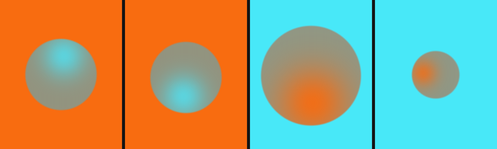

# IMU-visualiser — living gradient orb

POC for the **Waveshare ESP32-C6-Touch-AMOLED-2.06** watch: realtime QMI8658
IMU data rendered as an organic, breathing gradient orb on the 410×502 AMOLED,
after the Figma references (soft cyan/orange orbs on full-bleed colour).



## Motion → visual mapping

| Input | Effect |
| --- | --- |
| Tilt (gravity direction) | Glow hot-spot rolls around the orb like a bubble, with spring inertia and overshoot |
| Wrist rotation (gyro X/Y) | The whole orb is thrown across the screen and springs back to centre |
| Wrist rotation (gyro Z) | Tangential swirl on the hot-spot |
| Motion energy (linear accel) | Orb blooms — radius, glow reach and intensity swell, then settle slowly |
| Face-down flip | Palette crossfades: orange bg / cyan glow ↔ cyan bg / orange glow |
| Stillness | Slow breathing + lissajous drift keeps it alive |

If the IMU isn't found the app falls back to synthetic demo motion, so the
visual always runs.

## How it renders (no FPU, no GPU, no framebuffer)

The C6 has neither an FPU nor RAM for a full 410×502×16bpp framebuffer, so
`orb.c` renders in 16-row strips with a fixed-point inner loop: squared
distances to orb centre and hot-spot are tracked incrementally (no multiplies),
mapped through interpolated falloff LUTs, blended in RGB888 and packed to
Bayer-dithered RGB565 (the dither hides 565 contour banding on the shallow
gradients). Strips are double-buffered: strip N+1 is computed while strip N is
in QSPI DMA flight. Expected ~20–25 fps.

`amoled.c` talks to the CO5300 the same way Waveshare's Arduino stack does:
register writes as SPI cmd `0x02` / addr `reg<<8` on one line, pixels as cmd
`0x32` / addr `0x003C00` (DCS memory-write-continue) on four lines. Pin map in
`board.h`, verified against Waveshare's official demo repo and schematic.

## Build & flash

Requires **ESP-IDF ≥ 5.3**. ESP-IDF can't build from paths containing spaces
(this folder's parent has one), so go through a symlink:

```sh
ln -s "$(pwd)" /tmp/imu-visualiser
cd /tmp/imu-visualiser
idf.py set-target esp32c6
idf.py build flash monitor
```

Expected log:

```
amoled: CO5300 up: 410x502 QSPI @40 MHz
qmi8658: up: accel 4g/250Hz gyro 512dps/235Hz
imu-viz: 22.4 fps  energy=0.03 pal=0.00
```

## Host-side visual testing (no hardware)

`orb.c` is dependency-free, so the exact renderer can be run on a laptop:

```sh
cd test
cc -O2 -I../main host_orb_test.c ../main/orb.c -lm -o orb_test
./orb_test          # writes frame_0..3.ppm, one per Figma reference frame
```

## Files

```
main/board.h      pin map (Waveshare ESP32-C6-Touch-AMOLED-2.06)
main/amoled.c/h   minimal CO5300 QSPI driver, strip DMA with ping-pong
main/qmi8658.c/h  QMI8658 IMU driver (I2C 0x6B, accel 4g + gyro 512dps)
main/orb.c/h      fixed-point gradient-orb renderer (host-testable)
main/main.c       sensor fusion, animation springs, render loop
test/             host renderer harness
```

## Tuning

The feel lives in `main.c` (`anim_step` / `anim_to_params`): spring constants
`k`/`c`, energy attack/decay, breathing rate, palette colours. The look lives
in `orb.c` LUT shapes (edge smoothstep width, gaussian glow falloff).
